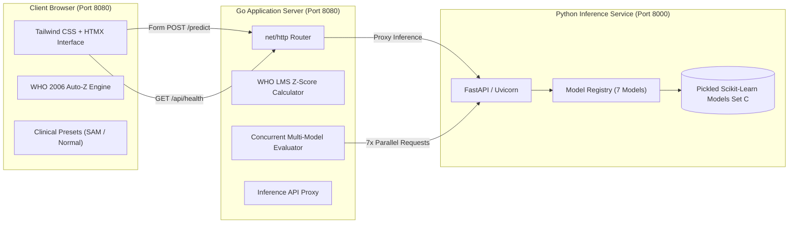

# Child Malnutrition Prediction System

[](https://golang.org)
[](https://python.org)
[](https://fastapi.tiangolo.com)
[](https://tailwindcss.com)
[](https://htmx.org)

This application is a clinical decision support platform for predicting acute child malnutrition ($\text{MUAC} < 12.5\text{ cm}$). It integrates a high-performance **Go web frontend** with a production-grade **FastAPI machine learning inference backend** hosting 7 benchmarked models trained on non-circular clinical predictors (**Predictor Set C**).

---

## 📌 Research Background & Non-Circular Methodology

### The Circular Data Leakage Problem
Earlier malnutrition prediction literature attempted to predict composite WHO Z-score categories ($WAZ, HAZ, WHZ$) using predictors derived from the exact same mathematical equations. This circular linkage produced artificial $>99\%$ accuracy that failed to generalize in real clinical triage.

### The Corrected Formulation (Predictor Set C)
- **Target Variable**: Reformulated to an independent clinical outcome: **Acute Malnutrition** defined by Mid-Upper Arm Circumference (**$\text{MUAC} < 12.5\text{ cm}$**).
- **Predictor Set C Features (8 Parameters)**:
  1. `month`: Child age in months (6–60 months)
  2. `sex_male`: Biological sex ($1 = \text{Male}, 0 = \text{Female}$)
  3. `area_noakhali`: Study district ($1 = \text{Noakhali}, 0 = \text{Lakshmipur}$)
  4. `weight`: Weight in kilograms (kg)
  5. `height`: Height/length in centimeters (cm)
  6. `waz`: WHO Weight-for-Age Z-score (-6.0 to +6.0)
  7. `haz`: WHO Height-for-Age Z-score (-6.0 to +6.0)
  8. `whz`: WHO Weight-for-Height Z-score (-6.0 to +6.0)
- **Recommended Model**: **Logistic Regression** with balanced class weighting ($AUC \approx 0.72$), offering full interpretability alongside 6 benchmarked algorithms.

---

## 🤖 7 Benchmarked Machine Learning Models

| Model Key (`model_name`) | Algorithm Class | Recommended | Clinical Characteristics |
|:---|:---|:---:|:---|
| **`logistic_regression`** | `Pipeline(StandardScaler, LogisticRegression)` | **Yes** | Selected optimal model. Balanced class weights, highly interpretable odds ratios, robust AUC (~0.72). |
| **`random_forest`** | `RandomForestClassifier` | No | Bagged ensemble of decision trees capturing non-linear feature interactions. |
| **`gradient_boosting`** | `GradientBoostingClassifier` | No | Sequential boosting ensemble optimizing deviance loss across Set C predictors. |
| **`stacking_ensemble`** | `StackingClassifier` | No | Heterogeneous meta-ensemble stacking base models with a logistic meta-learner. |
| **`svm_rbf`** | `Pipeline(StandardScaler, SVC)` | No | Support Vector Machine with Radial Basis Function kernel and calibrated probabilities. |
| **`mlp`** | `Pipeline(StandardScaler, MLPClassifier)` | No | Multi-Layer Perceptron neural network with backpropagation and tanh activation. |
| **`decision_tree`** | `DecisionTreeClassifier` | No | Single decision tree classifier with axis-aligned splits. |

---

## 🏗 System Architecture



---

## ⚡ Quick Start

### Option 1: Automatic 1-Click Startup (Recommended)

Start both the **Python ML service** (Port 8000) and the **Go Web Frontend** (Port 8080) concurrently:

#### On Windows (Batch / Command Prompt):
```bat
start-all.bat
```

#### On Windows (PowerShell):
```powershell
.\start-all.ps1
```

Once launched, your browser will open automatically at **[http://localhost:8080](http://localhost:8080)**.

---

### Option 2: Manual Multi-Terminal Startup

#### Terminal 1: Start Python FastAPI Inference Backend
```bash
cd "..\Malnutrition-Prediction-python-service"

# Activate virtual environment
# Windows:
.\venv\Scripts\activate
# Linux/macOS:
source venv/bin/activate

# Install dependencies if not already installed
pip install -r requirements.txt

# Start FastAPI server on port 8000
python -m uvicorn app.main:app --host 127.0.0.1 --port 8000 --reload
```
- API Base URL: `http://127.0.0.1:8000`
- Interactive Swagger Docs: `http://127.0.0.1:8000/docs`
- Health Probe: `http://127.0.0.1:8000/health`

#### Terminal 2: Start Go Web Frontend
```bash
cd "Predicting_malnutrition"

# Run Go application
go run main.go
```
- Web Application: **[http://localhost:8080](http://localhost:8080)**

---

## 📡 API Endpoints

### Go Web Frontend & Proxy Endpoints (Port 8080)

| Method | Endpoint | Description |
|:---:|:---|:---|
| `GET` | `/` | Serves main interactive clinical application |
| `POST` | `/predict` | Primary prediction handler (returns HTML partial for HTMX or JSON) |
| `POST` | `/api/predict` | JSON REST API: Evaluates single model inference |
| `POST` | `/api/predict-all` | JSON REST API: Evaluates all 7 models concurrently with consensus metrics |
| `GET` | `/api/health` | Comprehensive health probe checking Go frontend and Python backend |
| `GET` | `/api/models` | Registry catalog of all 7 machine learning models |
| `POST` | `/api/estimate-zscores` | Calculates accurate WHO 2006 Standard Z-scores ($WAZ, HAZ, WHZ$) |

---

### Request Payload Example (`POST /api/predict`)

```json
{
  "month": 24.0,
  "sex_male": 1,
  "area_noakhali": 1,
  "weight": 7.5,
  "height": 85.0,
  "waz": -3.5,
  "haz": -1.5,
  "whz": -3.8,
  "model_name": "logistic_regression"
}
```

### Response Example

```json
{
  "model_used": "logistic_regression",
  "model_file": "logistic_regression_set_c.pkl",
  "model_type": "Pipeline",
  "prediction": 1,
  "status": "Malnourished",
  "risk_probability": 0.7025,
  "risk_level": "High Risk",
  "model_loaded": true,
  "features_used": [24.0, 1, 1, 7.5, 85.0, -3.5, -1.5, -3.8],
  "feature_dict": {
    "month": 24.0,
    "sex_male": 1,
    "area_noakhali": 1,
    "weight": 7.5,
    "height": 85.0,
    "waz": -3.5,
    "haz": -1.5,
    "whz": -3.8
  },
  "latency_ms": 2
}
```

---

## 🩺 Clinical Triage Guidelines

Based on WHO Child Growth Standards and Community Management of Acute Malnutrition (CMAM) protocols:

1. **High Risk / Acute Malnutrition Detected ($\text{MUAC} < 12.5\text{ cm}$ or Risk $\ge 50\%$)**:
   - Immediate clinical examination for bilateral pitting edema.
   - Conduct appetite test with Ready-to-Use Therapeutic Food (RUTF).
   - If appetite test passes and no medical complications exist: Enroll in Outpatient Therapeutic Program (OTP).
   - If appetite test fails or severe complications/edema present: Urgent referral to inpatient stabilization facility.

2. **Moderate Risk / Borderline ($30\% \le \text{Risk} < 50\%$)**:
   - Enroll in Targeted Supplementary Feeding Program (TSFP) with RUSF / fortified foods.
   - Comprehensive Infant and Young Child Feeding (IYCF) counseling.
   - Schedule mandatory follow-up anthropometric evaluation within 14 days.

3. **Low Risk / Normal Nutritional Status ($\text{Risk} < 30\%$ and $\text{MUAC} \ge 12.5\text{ cm}$)**:
   - Reinforce standard preventive nutritional counseling and exclusive/continued breastfeeding.
   - Routine growth monitoring at next scheduled EPI vaccination visit.

---

## 🐳 Docker Deployment

A multi-stage `Dockerfile` is provided:

```bash
# Build Docker image
docker build -t predicting-malnutrition .

# Run container
docker run -d -p 8080:8080 -e PYTHON_API_URL="http://host.docker.internal:8000" --name malnutrition-app predicting-malnutrition
```

---

## 🧪 Testing

The automated test suite in the Python backend verifies all 7 models, schema constraints, and endpoints:

```bash
cd "..\Malnutrition-Prediction-python-service"
python tests\run_tests.py
```
*(All 10 test suites pass with 100% operational success).*

---

## 📄 License
This project is licensed under the MIT License - see the [LICENSE](LICENSE) file for details.
